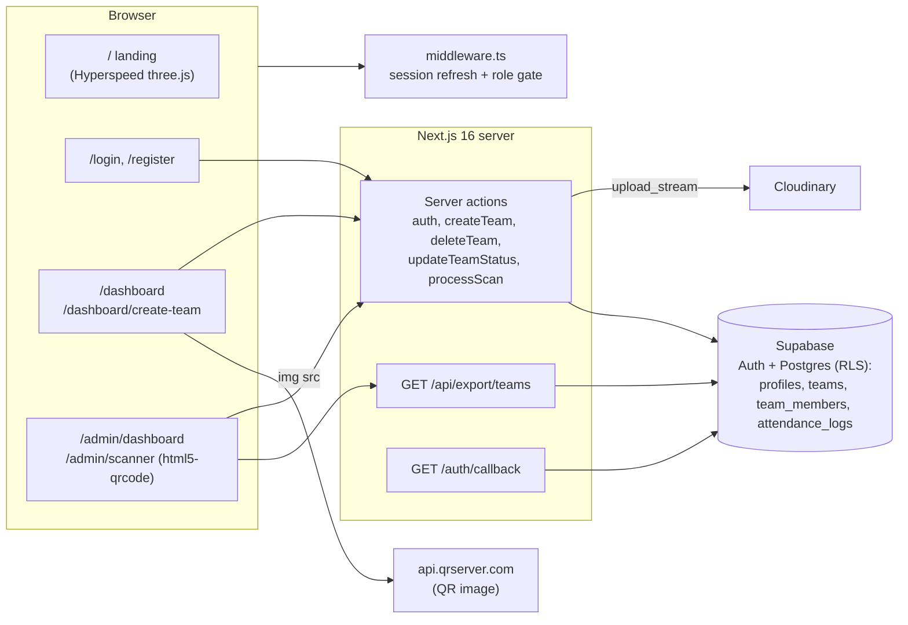

<!-- banner:start -->
<p align="center">
  <picture>
    <source media="(prefers-color-scheme: dark)" srcset=".github/assets/banner-dark.svg">
    
  </picture>
</p>
<!-- banner:end -->

# Prompt Engineering — event registration portal

Registration and door check-in site for the "Prompt Engineering Experience" college event: teams of 3 to 5 register, upload their payment screenshot and member photos, organisers approve payments from an admin dashboard, each approved team receives a QR ticket, and a phone-camera scanner marks attendance at the entrance.


Status: college event project (event held February 2026)

## Overview

**Problem.** Club events at college still collect registrations through Google Forms and UPI screenshots pasted into WhatsApp. Organisers spend hours matching payments to teams, and attendance on the day is a paper list that cannot stop a screenshot being reused at the door.

**Solution.** This portal gives each team leader an account, a single team record with members, and a payment-proof upload. Admins see every team with its proof and member photos, approve or reject with one click, and export a CSV. Approval unlocks a QR code that encodes the team id; the scanner page validates it server-side, rejects unapproved or already-scanned teams, and records every attempt in `attendance_logs`.

**Who it is for.** Built for the "Prompt Engineering Experience" event run by a college club; participants register as teams, organisers use the admin and scanner pages.

## Key features

- **Supabase auth with roles** — email/password (server actions in `src/app/auth/actions.ts`) and Google OAuth via `/auth/callback`; the role lives in `user_metadata.role` (`participant` by default, `admin`, `super_admin`, `kiosk`).
- **Route protection in middleware** — `src/utils/supabase/middleware.ts` refreshes the session cookie, sends anonymous users to `/login`, keeps signed-in users off `/login` and `/register`, and gates `/admin/*` (admin roles) and `/kiosk/*` (kiosk or admin).
- **Team creation in one server action** — `createTeam` uploads the payment proof and each member photo to Cloudinary (`payment-proofs/`, `member-photos/` folders, 10 MB server-action body limit), inserts the `teams` row with `status = 'pending'`, then inserts `team_members`.
- **Leader dashboard** — shows status (`pending`/`approved`/`rejected`), members, a delete-team action with ownership check, and the QR code once approved.
- **Admin dashboard** — counts (total, approved, pending, present), status filter via `?status=`, inline approve/reject forms, member photo thumbnails, CSV export link.
- **QR ticket and scanner** — approval sets `teams.qr_code = team.id`; the scanner page (`html5-qrcode`, 10 fps, 250 px box) calls `processScan`, which checks role, looks up the team, enforces `approved`, and blocks duplicates with a `duplicate` log entry.
- **CSV export** — `GET /api/export/teams` streams a quoted CSV (team, status, leader, payment link, created at) for admins.
- **Hyperspeed landing** — a three.js + `postprocessing` road-lights shader (`src/components/Hyperspeed.tsx`) with Framer Motion sections for date, venue, team size and rules.

## Architecture



| Component | Responsibility | Key files |
|---|---|---|
| Middleware | Cookie-based session refresh, public-path allow-list, role checks for `/admin` and `/kiosk` | `src/middleware.ts`, `src/utils/supabase/middleware.ts` |
| Supabase clients | Browser client, server (cookies) client | `src/utils/supabase/client.ts`, `server.ts` |
| Auth | `login`, `signup` (also inserts `profiles` row), `logout`; OAuth code exchange | `src/app/auth/actions.ts`, `src/app/auth/callback/route.ts`, `src/app/login/page.tsx`, `register/page.tsx` |
| Participant area | Layout with profile greeting and logout; dashboard; create-team form | `src/app/dashboard/layout.tsx`, `page.tsx`, `create-team/page.tsx`, `create-team/actions.ts`, `actions.ts` |
| Admin area | Team review and approval; scanner | `src/app/admin/dashboard/page.tsx`, `actions.ts`, `src/app/admin/scanner/page.tsx`, `actions.ts` |
| Export | CSV route handler | `src/app/api/export/teams/route.ts` |
| Visuals | Hyperspeed WebGL background, page transitions | `src/components/Hyperspeed.tsx`, `src/app/template.tsx` |
| Database policies | RLS for `teams` and `team_members`, admin read access | `fix_complete_rls.sql`, `fix_team_members_policy.sql` |

### Data flow — team lifecycle

1. **Register / sign in.** `signup` creates the auth user with `role: 'participant'` metadata and inserts a `profiles` row; the middleware then routes the user to `/dashboard`.
2. **Create team.** The leader fills team name, 3 to 5 members (name, registration number, optional photo) and a payment screenshot/PDF. `createTeam` uploads files to Cloudinary, inserts `teams` (`leader_id = auth.uid()`, `status = 'pending'`) and `team_members`, then redirects to `/dashboard`.
3. **Review.** An admin opens `/admin/dashboard`, inspects the proof link and member photos, and submits approve or reject. `updateTeamStatus` re-checks the role, updates `status` and, on approval, sets `qr_code = teamId`.
4. **Ticket.** The leader's dashboard now renders a QR image whose payload is the team id; before approval it shows "QR Code Locked".
5. **Check-in.** At the door an admin or kiosk account opens `/admin/scanner`; each decoded value goes to `processScan`, which inserts a `success` row in `attendance_logs` (or `duplicate` on a repeat) and shows the team name and members.
6. **Export.** `/api/export/teams` downloads `club-event-teams-<date>.csv` for the organisers' records.

### Data model

The committed SQL contains policies and two column safeguards; the base tables were created in the Supabase dashboard. From the code and policies:

| Table | Purpose | Important columns |
|---|---|---|
| `profiles` | One row per auth user | `id` (FK `auth.users`), `username`, `full_name`, `email`, `role` (`participant`/`admin`/`super_admin`/`kiosk`) |
| `teams` | One team per leader | `id`, `name`, `leader_id` (FK `profiles`), `payment_proof_link`, `status` (`pending`/`approved`/`rejected`), `qr_code`, `created_at` |
| `team_members` | Members of a team | `team_id` (FK `teams`), `name`, `reg_no`, `photo_url` |
| `attendance_logs` | Every scan attempt | `qr_code_scanned` (team id), `scanned_by` (user id), `status` (`success`/`duplicate`), timestamp |

RLS (from `fix_complete_rls.sql`): leaders can insert/select/update/delete their own `teams` row and select/insert/delete `team_members` of their team; `admin`/`super_admin` (checked through `profiles.role`) can select all teams and members.

## Tech stack

| Layer | Technology | Why |
|---|---|---|
| Framework | Next.js 16 (App Router, server actions, route handlers) + React 19 | Form handling and uploads without a separate API server |
| Auth / DB | Supabase Auth + Postgres with RLS via `@supabase/ssr` | Cookie sessions that work in middleware, server components and actions |
| File storage | Cloudinary (`cloudinary` SDK, `upload_stream`) | Reliable image hosting with folders and secure URLs |
| QR | `html5-qrcode` for scanning; qrserver.com image API for rendering | No native code; works in any phone browser |
| UI | Tailwind CSS 4, Framer Motion, lucide-react | Dark event theme with animated sections |
| 3D | three.js + `postprocessing` (bloom, SMAA) | The Hyperspeed hero effect |
| Fonts | Geist via `next/font` | Zero-layout-shift typography |

## Project structure

```
src/
  middleware.ts                    delegates to utils/supabase/middleware.ts
  utils/supabase/                  client.ts, server.ts, middleware.ts
  app/
    page.tsx                       landing: hero, event details, rules
    login/, register/              auth forms (email + Google)
    auth/actions.ts                login, signup, logout server actions
    auth/callback/route.ts         OAuth code exchange
    dashboard/                     layout.tsx (nav), page.tsx (team + QR), actions.ts (deleteTeam)
    dashboard/create-team/         page.tsx (form), actions.ts (createTeam + Cloudinary)
    admin/dashboard/               page.tsx (review table), actions.ts (updateTeamStatus)
    admin/scanner/                 page.tsx (html5-qrcode), actions.ts (processScan)
    api/export/teams/route.ts      CSV export
  components/Hyperspeed.tsx        three.js background
fix_complete_rls.sql               teams + team_members policies, admin read access
fix_team_members_policy.sql        team_members columns and policies
```

## Getting started

### Prerequisites

- Node.js 20+ and npm
- A Supabase project
- A Cloudinary account (free tier)

### Install, configure, run

```bash
git clone https://github.com/karteyareddy/promt-engineering.git
cd promt-engineering
npm install
# create .env.local with the variables below
npm run dev                     # http://localhost:3000
```

Windows: run the same commands in PowerShell; use `New-Item .env.local` to create the file.

### Environment variables

| Name | Required | Description | Where to get it |
|---|---|---|---|
| `NEXT_PUBLIC_SUPABASE_URL` | Yes | Supabase project URL | Supabase: Project Settings, API |
| `NEXT_PUBLIC_SUPABASE_ANON_KEY` | Yes | Public anon key; all data access goes through RLS | Supabase: Project Settings, API |
| `NEXT_PUBLIC_CLOUDINARY_CLOUD_NAME` | Yes | Cloudinary cloud name | Cloudinary dashboard |
| `CLOUDINARY_API_KEY` | Yes (server) | Upload API key, used only inside the `createTeam` server action | Cloudinary dashboard |
| `CLOUDINARY_API_SECRET` | Yes (server) | Upload API secret, server only | Cloudinary dashboard |

`.env*` is git-ignored.

### Supabase setup

1. Create the tables `profiles`, `teams`, `team_members` and `attendance_logs` with the columns listed under Data model (`teams.leader_id` must reference `profiles.id` so the `profiles!leader_id` joins work).
2. In the SQL editor run `fix_complete_rls.sql`, then `fix_team_members_policy.sql`.
3. Add an `update` policy for admins on `teams` and insert/select policies on `attendance_logs` for admin and kiosk roles (see Limitations).
4. Sign up through the app, then set `role = 'admin'` on your `profiles` row and in the auth user's metadata (Authentication > Users > edit `user_metadata`), because the middleware reads the metadata and the RLS reads `profiles`.
5. Optional: enable the Google provider and add `http://localhost:3000/auth/callback` to the redirect allow-list.

## Usage

| Route | Who | What |
|---|---|---|
| `/` | Public | Event hero, date and venue, team size, rules |
| `/register`, `/login` | Public | Create an account or sign in (email or Google) |
| `/dashboard` | Participant | Team status, members, delete team, QR ticket when approved |
| `/dashboard/create-team` | Participant | Team name, 3 to 5 members with photos, payment proof |
| `/admin/dashboard` | `admin`, `super_admin` | Filter by status, approve/reject, export CSV |
| `/admin/scanner` | `admin`, `super_admin`, `kiosk` | Camera scanner; shows Access Granted / Already Scanned / Not Approved |

### API endpoints

| Method | Path | Auth | Purpose |
|---|---|---|---|
| GET | `/api/export/teams` | Session with admin role | CSV of all teams with leader name and email |
| GET | `/auth/callback?code=` | Supabase OAuth | Exchange the PKCE code for a session and redirect |

Everything else is a server action invoked from a form (`createTeam`, `deleteTeam`, `updateTeamStatus`, `processScan`, `login`, `signup`, `logout`).

Example:

```bash
curl -b "sb-<project>-auth-token=<cookie>" http://localhost:3000/api/export/teams
# Team Name,Team ID,Status,Leader Name,Leader Email,Payment Link,Created At
# "Prompt Pirates","3f2c...","approved","A. Student","a@college.edu","https://res.cloudinary.com/...","2026-02-01T09:12:00Z"
```

## Security & privacy

- **Auth** — Supabase sessions in HTTP-only cookies, refreshed on every request by the middleware. Roles are checked in three places: middleware (page access), server actions (`updateTeamStatus`, `processScan`, export route) and Postgres RLS.
- **RLS** — leaders can only read and write their own team and members; admins get read access through a `profiles.role` subquery. `deleteTeam` additionally verifies `leader_id` before deleting.
- **Secrets** — the Cloudinary API key/secret are used only in server code and never prefixed `NEXT_PUBLIC_`; `.env*` is git-ignored.
- **PII** — the portal stores names, registration numbers, email addresses, member photos and payment screenshots (which can show UPI ids and bank names). Cloudinary URLs are unguessable but public; restrict access or delete the folders after the event, and avoid exporting the CSV to shared drives.
- **Ticket integrity** — the QR encodes only the team UUID; validity is decided server-side against `status` and `attendance_logs`, so a copied screenshot cannot be scanned twice.

## Testing & quality

- `npm run lint` — ESLint 9 with `eslint-config-next`.
- `npx tsc --noEmit` — type check.
- No automated tests yet. `processScan` and `updateTeamStatus` are pure server functions and are good candidates for unit tests with a mocked Supabase client.

## Deployment

Deploy to Vercel: import the repository, add the five environment variables, and set the Supabase Auth site URL and redirect URL (`https://<domain>/auth/callback`). The `/auth/callback` route already honours `x-forwarded-host` for production redirects. Any Node host running `npm run build && npm run start` works as well.

## Limitations & roadmap

- The committed SQL grants admins `select` only on `teams`; approve/reject (`update`) and `attendance_logs` writes depend on policies that were added in the Supabase dashboard. Commit those policies (an admin `update` policy on `teams`, insert/select on `attendance_logs`) so a fresh project works from the repo alone.
- `profiles` is inserted from the `signup` action rather than a database trigger, so Google OAuth sign-ups do not get a `profiles` row automatically.
- The QR image is fetched from a third-party service (`api.qrserver.com`); generate it locally (e.g. `qrcode` package) to remove the dependency.
- `googleapis`, `ogl`, `@react-three/fiber` and `@react-three/drei` are installed but unused; the export is plain CSV and the hero uses three.js directly.
- No email notifications on approval/rejection; participants must revisit the dashboard.
- Roadmap: commit full schema, trigger-based profile creation, local QR generation, approval emails, unit tests.

## Acknowledgements / credits

- Supabase, Cloudinary, `html5-qrcode`, three.js and `postprocessing`, Framer Motion, Tailwind CSS, lucide-react.

**License:** No license file yet.

## Author

Kristipati Karteya Reddy — GitHub [@karteyareddy](https://github.com/karteyareddy)
